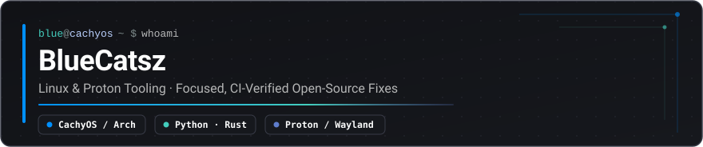

  

Linux power user and hobbyist developer running **CachyOS (Arch Linux)** with **KDE Plasma 6 (Wayland)**. I build lightweight utilities for Linux gaming/debugging workflows and contribute small, reproducible bug fixes to open-source projects.

### Featured Work

| Project / Contribution | Stack | Summary |
| :--- | :--- | :--- |
| [**ph-proton-launcher**](https://github.com/BlueCatsz/ph-proton-launcher) | Python · PyQt6 | Lightweight Linux desktop launcher for running Process Hacker or System Informer inside active Steam Proton prefixes via `protontricks-launch`. |
| [**Marvisak/VIctory#779**](https://github.com/Marvisak/VIctory/issues/779) | Rust · Windows ABI | Identified and fixed x64 COM ABI struct-return `RAX` handling across `victory-gpu` `GetDesc` methods with synthetic unit tests and Windows CI verification (merged downstream in [LAKSHYA-cmd-tech/VIctory#12](https://github.com/LAKSHYA-cmd-tech/VIctory/pull/12)). |

### How I Contribute

- **Minimal, scoped changes** — focused bug fixes and edge-case tests rather than broad, unrequested refactors.
- **Verified before submitting** — checked against local tests and GitHub Actions CI, with exact test scope documented.
- **Transparent workflow** — AI-assisted research and diff review are always disclosed when used, and every change is checked carefully before opening an issue or PR.

### Environment & Focus

- **System:** CachyOS (Arch Linux) · KDE Plasma 6 (Wayland) · Fish
- **Languages & Tools:** Python (`PyQt6`), Rust, Bash/Fish, Git, GitHub Actions
- **Interests:** Steam Proton / Wine prefix tooling, desktop usability utilities, and clean systems debugging
